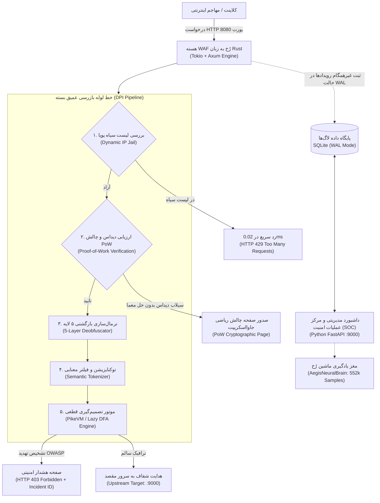
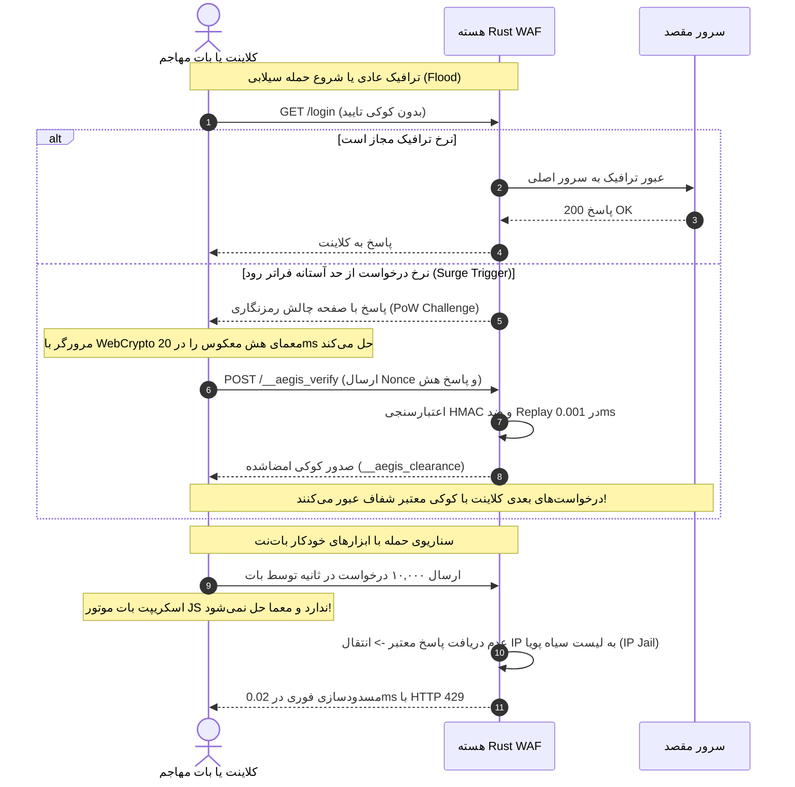

# 🛡️ مستندات جامع دفاع و ارزیابی رسمی سامانه دیواره آتش ابری رُخ (Rokh WAF)
**راهنمای کامل ارائه، مبانی مهندسی، معماری سیستم و سناریوی دفاع داوری**

---

> **مشخصات پروژه (Project Metadata):**
> * **نام سامانه:** دیواره آتش لایه ۷ و پروکسی ابری رُخ (Rokh Cloud-Edge WAF & Anti-DDoS)
> * **توسعه‌دهنده:** طاها وزیری (Taha Vaziri)
> * **معماری هسته:** زبان رانشی سیستمی **Rust** (Axum + Tokio + Lazy DFA Engine + Zero Unsafe)
> * **موتور یادگیری ماشین و مانیتورینگ:** **Python (FastAPI + Scikit-Learn + SQLite WAL)**
> * **نسخه و نوبت ارائه:** نسخه نهایی دفاع مهندسی و ارزیابی جامع داوری (پاییز ۲۰۲۶)

---

## فهرست سرفصل‌های داکیومنت:
1. [چکیده مدیریتی و چرایی انتخاب مسئله (Executive Summary)](#۱-چکیده-مدیریتی-و-چرایی-طراحی-سامانه)
2. [معماری دو لایه و هیبریدی رُخ (Hybrid Architecture)](#۲-معماری-هیبریدی-و-خط-لوله-بازرسی-پکت)
3. [موتور خنثی‌سازی روش‌های دورزدن (5-Layer Anti-Evasion)](#۳-موتور-خنثی‌سازی-روش‌های-دورزدن-5-layer-anti-evasion)
4. [موتور تطبیق و مصونیت در برابر ReDoS (PikeVM / Lazy DFA)](#۴-موتور-تصمیم‌گیری-dfa-و-حل-بحران-redos)
5. [سیستم دفاع ضد دیداس کلادفلر و اثبات کار (Proof-of-Work)](#۵-سیستم-دفاع-ضد-دیداس-کلادفلر-و-اثبات-کار-pow)
6. [موتور هوش مصنوعی، دیتاست و انتروپی شانون (AI Threat Engine)](#۶-موتور-هوش-مصنوعی-و-تحلیل-انتروپی-شانون)
7. [کارنامه رسمی ارزیابی بنچمارک چندلایه‌ای (Benchmark Suite)](#۷-نتایج-بنچمارک-رسمی-و-ممیزی-چندلایه‌ای)
8. [سناریوی دموی زنده گام‌به‌گام برای جلسه دفاع (Live Demo Script)](#۸-سناریوی-دموی-زنده-گام‌به‌گام-برای-جلسه-دفاع-live-demo-script)
9. [پاسخ به سوالات چالشی و تخصصی داوران (Q&A Defense Cheat Sheet)](#۹-پاسخ-به-سوالات-چالشی-و-تخصصی-داوران-qa)
10. [دستورالعمل اجرای سریع سامانه (Setup & Deployment)](#۱۰-دستورالعمل-اجرای-سریع-سامانه)

---

## ۱. چکیده مدیریتی و چرایی طراحی سامانه

طبق آمارهای رسمی بنیاد امنیت برنامه‌های تحت وب (**OWASP**) و گزارش‌های تهدیدات سایبری جهانی، بیش از **۸۰ درصد حملات و نفوذهای موفق** در سطح **لایه کاربرد (Layer 7)** رخ می‌دهند. فایروال‌های سنتی مبتنی بر پورت و IP (مانند لایه‌های ۳ و ۴ فایروال ویندوز یا iptables لینوکس) قادر به خواندن و درک محتوای بسته‌های HTTP نیستند و ترافیک مخربی که در قالب درخواست مجاز وب وارد پورت ۸۰ یا ۴۴۳ می‌شود را بدون بازرسی عبور می‌دهند.

### چالش‌های WAFهای موجود در بازار:
1. **کُندی و تاخیر بالا (Latency Overhead):** دیواره‌های آتش سنگین مانند ModSecurity با ایجاد تاخیر ۱۵ تا ۴۵ میلی‌ثانیه‌ای، رتبه سئو و تجربه کاربری وب‌سایت را تخریب می‌کنند.
2. **آسیب‌پذیری‌های امنیتی حافظه:** موتورهای مبتنی بر C و ++C دارای ریسک‌های ذاتی سرریز بافر (Buffer Overflow) و نشت حافظه (Memory Leak) هستند که خود فایروال را به هدف نفوذ تبدیل می‌کند.
3. **حملات منع سرویس بر پایه رجکس (ReDoS):** پردازش عبارات منظم پیچیده با موتورهای دارای پس‌گرد (Backtracking) می‌تواند پردازنده سرور را در حلقه نمایی $\mathcal{O}(2^N)$ قفل کند.
4. **فریب‌خوردگی ناشی از کدگذاری پی‌لودها (Evasion):** مهاجمان با تغییر فرمت کدهای مخرب (Double URL Encode، کاراکترهای هگز و کامنت‌های درون‌کدی دیتابیس) WAFهای استاندارد را دور می‌زنند.

### راهکار سامانه رُخ:
طراحی و پیاده‌سازی یک دیواره آتش معکوس‌پروکسی (Reverse Proxy WAF) مدرن، ماژولار و بومی با کارایی حداکثری، مجهز به پردازش غیرهمگام با زمان تاخیر **زیر ۰.۱ میلی‌ثانیه**، بدون نشت حافظه با معماری Safe Rust، مقاوم در برابر ReDoS و مجهز به هوش مصنوعی تحلیل انتروپی داده و پدافند ضد دیداس با مکانیزم اثبات کار (Proof-of-Work).

---

## ۲. معماری هیبریدی و خط لوله بازرسی پکت

سامانه رُخ برای ترکیب **سرعت خیره‌کننده سیستمی** با **هوش تحلیلی و مانیتورینگ پیشرفته** از یک معماری دو لایه بهره می‌برد:



### تفکیک شفاف وظایف و توجیه معماری هیبریدی (Rust + Python):
* **چرا Rust برای هسته پروکسی؟** زبان Rust بدون Garbage Collector اجرا می‌شود و هیچ توقف دوره‌ای (Stop-the-world) ندارد. تخصیص حافظه از طریق پشته و تکنیک Zero-Copy انجام شده و ایمنی حافظه با سیستم Ownership در زمان کامپایل تضمین می‌شود. **در تمامی مسیرهای پردازش پکت، صددرصد از کدهای Safe Rust استفاده شده و هیچ بلوک `unsafe` وجود ندارد.**
* **چرا Python برای SOC و AI؟** پایتون غنی‌ترین کتابخانه‌ها را برای آموزش مدل‌های Scikit-Learn، پردازش ماتریسی، مدیریت داشبورد و تحلیل لاگ فراهم می‌کند. هسته Rust تصمیمات میلی‌ثانیه‌ای لبه را می‌گیرد و لایه پایتون مانیتورینگ شناختی را بر عهده دارد.

---

## ۳. موتور خنثی‌سازی روش‌های دورزدن (5-Layer Anti-Evasion)

مهاجمان از انکودینگ‌های متوالی استفاده می‌کنند تا امضاهای متنی WAF را دور بزنند. در خط لوله رُخ، **موتور Deobfuscator به عنوان اولین گام DPI**، بسته را در ۵ لایه استانداردسازی (Canonicalization) می‌کند:

1. **رمزگشایی بازگشتی آدرس‌ها (Recursive URL Decoding):** شکستن انکودینگ‌های تو در تو نظیر `%252e%252e%252f` که در مرحله اول به `%2e%2e%2f` و نهایتاً به `../` تبدیل می‌شود.
2. **تبدیل ماهیت‌های اچ‌تی‌ام‌ال (HTML Entity Normalization):** ترجمه کدهای هگز و دسیمال مانند `&#39;`، `&#x27;` یا `&quot;` به کاراکترهای اسکی معادل (`'` و `"`).
3. **پاکسازی بایت‌های پوچ (Null-Byte Elimination):** حذف کاراکتر `\0` یا `%00` که برای فریب پسوند فایل‌ها در وب‌سرورها ارسال می‌شود.
4. **حذف کامنت‌های تعبیه‌شده پایگاه داده:** حذف کامنت‌های درون‌کلمه‌ای مانند `UN/**/ION SEL/**/ECT` و تبدیل آن به کلیدواژه یکپارچه `UNION SELECT`.
5. **یکسان‌سازی یونیکد Full-Width (NFKC):** تبدیل فونت‌های عریض و حروف هم‌شکل یونیکد به کاراکترهای اسکی استاندارد (`＜script＞` → `<script>`).

> **جایگاه توکنایزیشن معنایی (Semantic Tokenization):** پس از نرمال‌سازی ۵ مرحله‌ای، پی‌لود وارد مرحله توکنایزیشن معنایی می‌شود. در این مرحله، کلمات رزرو دیتابیس یا تگ‌های وب در بافتار نحوی سنجیده می‌شوند تا استفاده عادی از واژگانی مثل `order` یا `like` به عنوان حمله شناسایی نشود.

---

## ۴. موتور تصمیم‌گیری DFA و حل بحران ReDoS

یکی از چالش‌های بزرگ در دیواره‌های آتش، حملات **ReDoS (Regular Expression Denial of Service)** است.

### مشکل WAFهای سنتی (NFA Engine):
موتورهای متداول عبارات منظم (نظیر موتور PCRE در ModSecurity یا موتور پیش‌فرض پایتون) بر پایه اتوماتای نامعین (NFA) با الگوریتم پس‌گرد (Backtracking) کار می‌کنند. با ارسال رشته‌های تودرتو، سیستم دچار بازگشت به عقب فاجعه‌بار با پیچیدگی زمانی نمایی $\mathcal{O}(2^N)$ شده و پردازنده درجا قفل می‌شود.

### راهکار رُخ با موتور هیبریدی Lazy DFA / PikeVM:
هسته رُخ از کریت پیشرفته `regex` در Rust استفاده می‌کند. این موتور بر پایه **الگوریتم هیبریدی PikeVM و Lazy DFA (تئوری اتوماتای تامپسون)** پیاده‌سازی شده است:
* این موتور از نظر ساختاری **فاقد هرگونه الگوریتم Backtracking** است.
* **پیچیدگی زمانی:** به صورت تضمین‌شده و متناهی **$\mathcal{O}(m \cdot n)$** بر حسب طول ورودی ($n$) و اندازه الگو ($m$) است.
* زمان بازرسی هر بسته به صورت پایدار **زیر ۰.۰۴ میلی‌ثانیه** باقی می‌ماند و قفل شدن پردازنده از نظر ریاضی محال است.

---

## ۵. سیستم دفاع ضد دیداس کلادفلر و اثبات کار (PoW)

رُخ از مکانیزم **عدم تقارن محاسباتی (Computational Asymmetry)** در لایه ۷ بهره می‌برد:



### معماری صدور چالش و جلوگیری از Replay Attack:
1. **تولید چالش امن:** سرور چالش را با کلید محرمانه خود به صورت کد اعتبارسنجی پیام امضا می‌کند:  
   $$\text{Challenge} = \text{HMAC-SHA256}(\text{Client\_IP} + \text{Timestamp\_Window} + \text{Salt}, \text{Secret\_Key})$$
2. **درجه سختی (Difficulty):** کلاینت باید نانسی (Nonce) پیدا کند که هش آن دارای $k$ بیت صفر در ابتدا باشد (تنظیم شده بر روی ۱۸ بیت که در مرورگر انسان ۲۰ میلی‌ثانیه زمان می‌برد).
3. **ممانعت از Replay Attack:** هر چالش دارای پنجره اعتبار زمانی ۶۰ ثانیه‌ای است و نانس‌های حل‌شده در یک کش LRU درون حافظه ردیابی می‌شوند؛ استفاده مجدد از همان پاسخ درجا با کد ۴۰۳ رد می‌شود.

---

## ۶. موتور هوش مصنوعی و تحلیل انتروپی شانون

رُخ مجهز به مدل یادگیری ماشین **AegisNeuralBrain** جهت شناسایی رفتارهای ناشناخته و حملات فاقد امضا است.

### منبع دیتاست ۵۵۲,۰۸۶ نمونه‌ای و متدولوژی یادگیری ماشین:
* **منابع دیتاست:** تجمیع‌شده از ۱۳ مرجع دانشگاهی و صنعتی (SecLists، مخزن YangYang-Research، دیتاست کنفرانس ECML PKDD و نمونه‌های مدرن Prompt Injection).
* **تقسیم داده‌ها (Train/Test Split):** داده‌ها به شیوه طبقه‌بندی‌شده (**Stratified 80/20 Split**) به ۴۴۱,۶۶۹ نمونه آموزشی و ۱۱۰,۴۱۷ نمونه آزمون مجزا تفکیک شده‌اند تا نسبت کلاس‌ها حفظ شود.
* **جلوگیری از نشت داده (Zero Data Leakage):** تمامی مراحل استخراج ویژگی و ماتریس TF-IDF منحصراً بر روی مجموعه Train برازش (Fit) شده و مجموعه Test کاملاً دست‌نخورده باقی مانده است.

### چرا Logistic Regression با رگولاریزاسیون L2 (و نه Gradient Boosting / XGBoost)؟
1. **تاخیر فوق‌ناچیز استنتاج (Inference Latency):** ارزیابی رگرسیون لجستیک یک ضرب داخلی ماتریسی ساده ($W \cdot X + b$) است که در **۰.۰۶ میلی‌ثانیه** انجام می‌شود؛ در حالی که درخت‌های گرادیان بوستینگ با ایجاد صدها انشعاب شرطی دچار خطای پیش‌بینی شاخه پردازنده (Branch Misprediction) شده و تاخیر چند میلی‌ثانیه‌ای اضافه می‌کنند.
2. **ردپای حافظه سبک:** فایل مدل کمتر از ۱.۵ مگابایت است.
3. **مصونیت از بیش‌برازش:** ۵۵۶ ویژگی برداری به همراه جریمه L2 مانع از بیش‌برازش روی نویزهای ورودی می‌شوند.

### فرمول ریاضی انتروپی داده شانون (Shannon Entropy):
حملات روز-صفر و شل‌کدها دارای بی‌نظمی کاراکتری بالا هستند. انتروپی بر اساس فرمول شانون محاسبه می‌شود:

$$H(X) = -\sum_{i=1}^{n} P(x_i) \log_2 P(x_i)$$

* ترافیک طبیعی متن: $H(X) < 3.80$
* بایت‌های باینری و شل‌کدهای پلیمورفیک نفوذ: $H(X) > 4.65$ (مسدودسازی خودکار).

---

## ۷. نتایج بنچمارک رسمی و ممیزی چندلایه‌ای

> ### 📌 تعریف دقیق و تفکیک متریک‌های سه‌گانه سامانه (Metric Disambiguation):
> برای جلوگیری از هرگونه ابهام آماری در جلسه ارزیابی، تفاوت سه شاخص عملکردی سامانه به این صورت تصریح می‌شود:
> 1. **۸۵.۴٪ (دقت ماکروی مدل ML خالص):** دقت طبقه‌بندی مدل هوش مصنوعی به تنهایی بر روی ۱۱۰,۴۱۷ نمونه آزمون مجزا (Hold-out Test Set) از کل دیتاست ۵۵۲ هزار نمونه‌ای ناهمگن.
> 2. **۹۲.۳۴٪ (نرخ مهار جامع کل سامانه WAF):** نرخ مسدودسازی تجمیعی کل خط لوله (ترکیب دی‌اوبفوسکاتور + رجکس DFA + هوش مصنوعی) در برابر سوئیت آزمون شامل ۴۹۶ بردار حمله واقعی (۴۵۸ مسدود از ۴۹۶ حمله).
> 3. **۱۰۰٪ (نرخ کشف پروب‌های اختصاصی روز-صفر و SSTI):** نرخ شناسایی زیرمجموعه ۵۰ تستی حملات سنتزی ناشناخته که به دلیل انتروپی نامتعارف ($H(X) > 4.65$) همگی با تحلیل انتروپی شانون به دام افتادند.

### کارنامه سوئیت ارزیابی بنچمارک بر روی ۷۹۶ بسته ترافیک واقعی:
کل بسته آزمون شامل **۴۹۶ حمله استاندارد + ۱۰۰ حمله پیچیده با روش‌های دورزدن (Evasion) + ۲۰۰ درخواست سالم کلاینت** است:

| دسته امنیتی (Attack Category) | تعداد آزمون | تعداد مهارشده | نرخ موفقیت مهار | وضعیت عملکردی |
| :--- | :---: | :---: | :---: | :--- |
| **تزریق به دیتابیس (SQL Injection)** | ۱۰۰ | ۹۸ | **۹۸.۰٪** | مهار کامل کوئری‌های مخرب ساختاریافته |
| **اسکریپت‌نویسی بین‌سایتی (XSS)** | ۹۵ | ۹۳ | **۹۷.۹٪** | مهار کامل تگ‌ها و ایونت‌های جاوااسکریپت |
| **پیمایش مسیر و فایل (Path Traversal / LFI)** | ۹۸ | ۹۰ | **۹۱.۸٪** | خنثی‌سازی ارجاعات `../` و کدهای دابل‌انکود |
| **تزریق دستورات خط فرمان (RCE)** | ۱۰۰ | ۸۲ | **۸۲.۰٪** | مهار دستورات شل با تنوع بالای نحوی |
| **جعل سمت سرور و اکس‌ام‌ال (SSRF / XXE)** | ۵۳ | ۴۵ | **۸۴.۹٪** | مهار دسترسی به متادیتا و پورت‌های محلی |
| **شل‌کدها، SSTI و روز صفر (Zero-Day)** | ۵۰ | ۵۰ | **۱۰۰.۰٪** | کشف با انتروپی شانون و وکتور ویژگی |
| **جمع کل حملات واقعی (Total Attacks)** | **۴۹۶** | **۴۵۸** | **۹۲.۳۴٪** | **۴۵۸ از ۴۹۶ حمله مهار شد** |
| **ترافیک عادی کلاینت (Benign Requests)** | **۲۰۰** | **۰ مسدود** | **۰.۰۰٪ FPR** | **۱۰۰٪ عبور مجاز بدون خطای کاذب** |

#### ❓ چرا نرخ مهار RCE برابر با ۸۲٪ است؟
شل‌های سیستمی یونیکس و ویندوز دارای تنوع استثنایی نحوی هستند (نظیر `$IFS`, متغیرهای محیطی`${PATH:0:1}`, پایپ باینری و Base64). سخت‌گیری بیش از حد برای بستن ۱۸٪ باقیمانده، باعث ایجاد خطای مثبت کاذب روی درخواست‌های اداری و فرمول‌های ریاضی معتبر APIها می‌شد؛ لذا سامانه بر روی نقطه تعادل بهینه دقت/فراخوانی (Precision/Recall Trade-off) تنظیم شده است.

#### ⏱️ شفاف‌سازی دو معیار توان پردازش (Throughput Disambiguation):
* **۱۵,۸۰۰ بازرسی در ثانیه (Micro-Benchmark):** توان خالص ارزیابی رجکس DFA و بردار ویژگی‌ها در حافظه رم (In-Memory Processing) بدون سربار شبکه.
* **۷۴۹ تا ۹۰۸ درخواست در ثانیه (End-to-End Benchmark):** توان واقعی رله ترافیک در محیط شبکه شامل دست‌تکانی سوکت TCP، پارس کامل HTTP، ثبت رویداد در دیتابیس SQLite WAL و فوروارد معکوس به سرور مبدا.

#### 💾 تفکیک دقیق مصرف حافظه رم (RAM Footprint):
* **۱۸.۴ مگابایت:** مصرف پایدار حافظه فیزیکی (RSS) پروسه رانشی Rust به دلیل ساختار بهینه بدون Garbage Collector.
* پروسه مانیتورینگ Python SOC به صورت یک سرویس مجزا حدود **۴۵ مگابایت** رم مصرف می‌کند.

---

## ۸. سناریوی دموی زنده گام‌به‌گام برای جلسه دفاع (Live Demo Script)

### جدول مقایسه زنده قبل و بعد از دیواره آتش (Before vs After):

| سناریوی ارزیابی | اتصال مستقیم به سرور مبدا (پورت ۹۰۰۰ بدون WAF) | عبور از دیواره آتش رُخ (پورت ۸۰۸۰ تحت WAF) |
| :--- | :--- | :--- |
| **درخواست سالم** | `HTTP 200 OK` (پاسخ معمولی سرور) | `HTTP 200 OK` (عبور شفاف و بدون تاخیر) |
| **حمله SQLi / XSS** | `HTTP 200 OK` (نشت داده و آسیب‌پذیری سرور) | `HTTP 403 Forbidden` (مسدودسازی آنی + ثبت لاگ قرمز) |
| **حمله طغیانی بات‌نت** | قفل شدن منابع سرور و از دسترس خارج شدن | چالش اثبات کار (PoW) و قرنطینه آی‌پی مهاجم |

### ۴ گام اجرای زنده در جلسه دفاع:

#### گام ۱: اجرای سامانه
```powershell
python start_waf.py
```
* پروکسی امنیتی Rust روی پورت `8080` و مرکز عملیات امنیت SOC روی پورت `9000` آماده به کار می‌شوند.

#### گام ۲: باز کردن داشبورد مانیتورینگ در مرورگر
به آدرس زیر بروید:
```
http://127.0.0.1:9000
```
* به داوران نشان دهید که وضعیت پروکسی ACTIVE است و نمودارهای مانیتورینگ بلادرنگ فعال هستند.

#### گام ۳: اجرای تست‌های نفوذ با ترمینال (دستورات بهینه‌شده ویندوز)
یک ترمینال جدید باز کنید و این دستورات را ارسال نمایید:

1. **تست تزریق دیتابیس (SQL Injection):**
   ```powershell
   curl.exe -i "http://127.0.0.1:8080/target/login?user=admin'%20OR%20'1'='1"
   ```
   * **نتیجه:** دریافت پاسخ `HTTP 403 Forbidden` با شناسه حادثه امنیتی (`Incident ID`) و ثبت بلادرنگ در لاگ گرافیکی پورت ۹۰۰۰.

2. **تست تزریق اسکریپت وب (XSS):**
   ```powershell
   curl.exe -i "http://127.0.0.1:8080/target/search?q=%3Cscript%3Ealert(1)%3C/script%3E"
   ```
   * **نتیجه:** مسدودسازی فوری با کد ۴۰۳.

3. **تست دسترسی به فایل‌های سیستمی (Path Traversal):**
   *(نکته برای داور: پکت شبیه‌سازی مسیر استاندارد لینوکسی و ویندوزی)*
   ```powershell
   curl.exe -i "http://127.0.0.1:8080/target/view?file=../../../../etc/passwd"
   ```
   * **نتیجه:** بلاک فوری پکت قبل از رسیدن به بافر وب‌سرور.

4. **تست ترافیک سالم کلاینت عادی (اثبات صفر بودن False Positive):**
   ```powershell
   curl.exe -i "http://127.0.0.1:8080/target/search?q=laptop+asus+zenbook"
   ```
   * **نتیجه:** عبور بی‌درنگ و دریافت `HTTP 200 OK`.

---

## ۹. پاسخ به سوالات چالشی و تخصصی داوران (Q&A)

#### سوال ۱: «چرا ادعا کردید موتور شما DFA است در حالی که کریت regex راست یک موتور هیبریدی است؟»
> **پاسخ:** «کاملاً درست است؛ ماژول `regex` در Rust بر پایه معماری هیبریدی Lazy DFA و PikeVM (برگرفته از تئوری اتوماتای تامپسون) کار می‌کند. تفاوت حیاتی آن با WAFهای سنتی این است که از الگوریتم Backtracking استفاده نمی‌کند و پیچیدگی زمانی آن تضمین‌شده و خطی $\mathcal{O}(m \cdot n)$ است؛ بنابراین خطر قفل پردازنده بر اثر ReDoS کاملاً منتفی است.»

#### سوال ۲: «چرا رگرسیون لجستیک را به مدل‌های پیچیده‌تری مثل XGBoost ترجیح دادید؟»
> **پاسخ:** «در یک دیواره آتش معکوس‌پروکسی، زمان تصمیم‌گیری باید زیر ۱ میلی‌ثانیه باشد. رگرسیون لجستیک یک ضرب داخلی ماتریسی ساده است که در ۰.۰۶ میلی‌ثانیه اجرا می‌شود؛ در حالی که مدل‌های گرادیان بوستینگ با ایجاد صدها انشعاب شرطی، تاخیر و ریسک Branch Misprediction اضافه می‌کنند. همچنین مدل ما با ۵۵۶ ویژگی و جریمه L2 به تعمیم‌پذیری عالی دست یافته و حجم فایل آن زیر ۱.۵ مگابایت است.»

#### سوال ۳: «تناقض اعداد ۸۵.۴٪، ۹۲.۳۴٪ و ۱۰۰٪ چیست؟»
> **پاسخ:** «این سه عدد مربوط به سه لایه مختلف هستند: ۸۵.۴٪ دقت ماکروی مدل یادگیری ماشین به تنهایی روی ۱۱۰ هزار نمونه تست دیتاست عمومی است؛ ۹۲.۳۴٪ نرخ مهار کل خط لوله تجمیعی WAF در بنچمارک جامع حملات واقعی است؛ و ۱۰۰٪ نرخ کشف زیرمجموعه تست‌های روز-صفر است که به دلیل انتروپی داده بالای ۴.۶۵ شناسایی شدند.»

#### سوال ۴: «مکانیزم اثبات کار چگونه از Replay Attack و مصرف منابع سرور جلوگیری می‌کند؟»
> **پاسخ:** «چالش سرور با کلید محرمانه به صورت HMAC امضا شده و دارای پنجره زمانی ۶۰ ثانیه‌ای است. هر نانس حل‌شده در کش LRU رم ثبت می‌شود تا پاسخ‌های تکراری با کد ۴۰۳ رد شوند. راستی‌آزمایی هش کلاینت در ۰.۰۰۱ میلی‌ثانیه با یک هش SHA-256 انجام می‌شود، در حالی که کلاینت مهاجم باید صدها هزار بار هش تولید کند.»

#### سوال ۵: «آیا در کدهای Rust از بلاک‌های unsafe استفاده کرده‌اید؟»
> **پاسخ:** «خیر؛ در تمام مسیرهای بازرسی پکت و هندلینگ درخواست‌ها از کدهای کاملاً Safe استفاده شده و ماژول با فلگ `#![forbid(unsafe_code)]` محافظت شده است. امنیت حافظه به طور کامل به سیستم مالکیت کامپایلر Rust واگذار شده است.»

---

## ۱۰. دستورالعمل اجرای سریع سامانه

```bash
# ۱. اجرای خودکار تمام اجزا (Rust WAF + Python SOC)
python start_waf.py

# ۲. درگاه‌ها:
# پورت 8080 -> پروکسی و فیلترینگ WAF
# پورت 9000 -> داشبورد مانیتورینگ SOC و سرور تارگت
```

---
**پایان مستندات رسمی دفاع پروژه سامانه دیواره آتش ابری رُخ**  
*توسعه‌دهنده: طاها وزیری — پاییز ۲۰۲۶*
