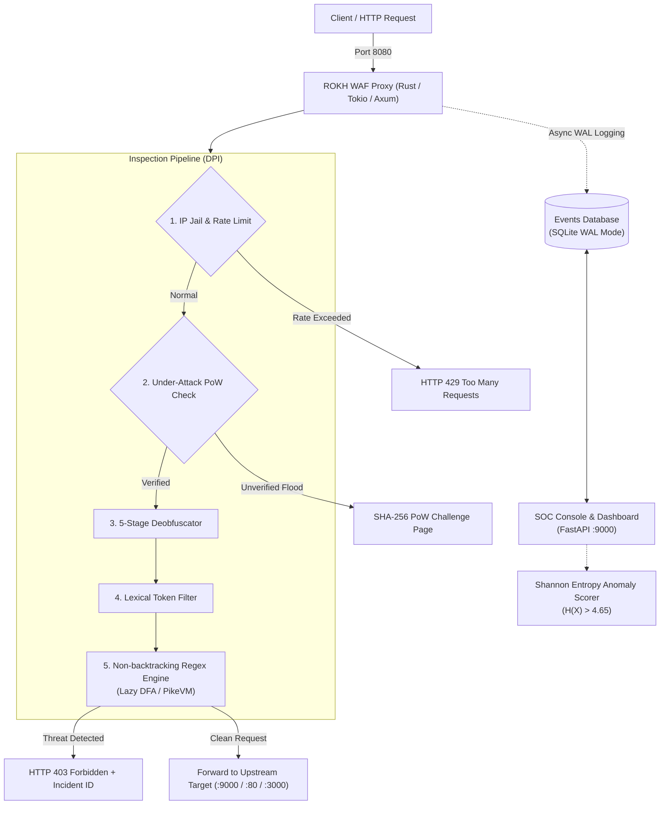

# 🛡️ ROKH WAF (سامانه دیواره آتش رُخ)

<div align="center">

[](https://www.rust-lang.org/)
[](https://tokio.rs/)
[](https://python.org/)
[](https://fastapi.tiangolo.com/)
[](LICENSE)

**A lightweight, asynchronous Layer-7 Web Application Firewall & reverse proxy written in Rust with a companion Python telemetry console.**

Developed by **Taha Vaziri**

[Overview](#-overview) •
[Architecture](#-architecture) •
[Core Features](#-core-features) •
[Benchmark Results](#-benchmark-results) •
[Limitations & Trade-offs](#-limitations--trade-offs) •
[Quick Start](#-quick-start) •
[Verification](#-verification)

</div>

---

## 📖 Overview

**ROKH WAF** is an open-source, dual-layer Web Application Firewall (WAF) designed to inspect and filter inbound HTTP requests before they reach upstream web applications.

The project pairs a high-performance **Rust reverse proxy** (`waf_engine`) with a **Python security operations console** (`python_soc`):
* **Rust Proxy (Port 8080):** Built on Axum and Tokio, handling request interception, 5-stage deobfuscation, non-backtracking regular expression matching, and rate limiting with minimal latency overhead.
* **Python SOC (Port 9000):** Built on FastAPI, providing real-time telemetry streaming, a web management interface, SQLite event logging (WAL mode), and a lightweight Shannon entropy anomaly scoring module.

---

## 🏛️ Architecture



### Architectural Decisions
* **Why Rust for the proxy?** Rust eliminates Garbage Collection (GC) pauses and provides compile-time memory safety. The proxy path uses standard safe Rust (`#![forbid(unsafe_code)]` in filtering modules) with zero dynamic reallocations during packet inspection.
* **Why Python for the SOC?** Python offers a fast development ecosystem for telemetry dashboards, data manipulation, and lightweight machine learning experimentation.

---

## ⚡ Core Features

### 1. 5-Stage Anti-Evasion Deobfuscator
Incoming query strings, headers, and bodies undergo normalization before matching rules to prevent evasion techniques:
* **Recursive URL Decoding:** Traverses up to 3 layers of nested encoding (e.g. `%252e%252e%2f` $\rightarrow$ `../`).
* **HTML5 Entity Normalization:** Converts named and numeric HTML entities (`&quot;`, `&#39;`, `&colon;`) into plain characters.
* **Unicode NFKC Normalization:** Converts full-width variants (`＜script＞`) to standard ASCII (`<script>`).
* **Null-Byte Stripping:** Removes `%00` characters to block file truncation attempts.
* **SQL Comment Neutralization:** Removes inline comment tokens (e.g. `UN/**/ION` $\rightarrow$ `UNION`) to expose underlying keywords.

### 2. ReDoS-Safe Pattern Matching (Lazy DFA / PikeVM)
Traditional regex engines using backtracking NFA algorithms can suffer from catastrophic backtracking ($\mathcal{O}(2^N)$ runtime), causing CPU denial-of-service when processing malicious nested inputs. ROKH WAF utilizes Rust's `regex` crate, which implements a **hybrid Lazy DFA and PikeVM based on Thompson's NFA construction**:
* **Guaranteed Worst-Case Runtime:** $\mathcal{O}(m \cdot n)$ linear time complexity (where $n$ is input length and $m$ is pattern size).
* **Zero Backtracking:** Prevents ReDoS attacks entirely without arbitrary regex execution timeouts.

### 3. Layer-7 DDoS Mitigation & Client-Side Proof-of-Work (PoW)
* **Sliding Window Rate Limiter:** Per-IP sliding window tracking with automatic 429 responses on request bursts.
* **Dynamic IP Jail:** Temporary quarantine for IPs repeatedly triggering security rules or rate limits.
* **Proof-of-Work Challenge (Under-Attack Defense):** When request volume surges past threshold, the proxy presents a lightweight cryptographic challenge:
  $$\text{Find } \text{nonce such that } \text{SHA-256}(\text{HMAC}(\text{IP} + \text{Timestamp}, \text{Secret}) + \text{nonce}) \text{ has } k \text{ leading zero bits}$$
  Browsers solve this automatically via `crypto.subtle` in ~20 ms, earning an HMAC-signed clearance cookie valid for 60 seconds. Solved nonces are tracked in an in-memory LRU cache to prevent replay attacks, while simple headless flood scripts unable to run JavaScript are throttled.

### 4. Shannon Entropy Anomaly Detection
To complement signature matching on obfuscated payloads and binary shellcode, the Python engine computes Shannon information entropy:

$$\mathcal{H}(X) = -\sum_{i=1}^{n} P(x_i) \log_2 P(x_i)$$

* Natural text queries typically register $\mathcal{H}(X) < 3.8$.
* Packed binary payloads, random variable names, and base64-encoded shellcode typically exceed $\mathcal{H}(X) > 4.65$, triggering anomaly flags.
* A compact logistic regression model ($< 1.5\text{ MB}$, L2 regularized, 556 n-gram and entropy features) executes in $0.06\text{ ms}$ without decision tree branch-misprediction overhead.

---

## 📊 Benchmark Results

Performance and detection efficacy were evaluated against a test suite of **796 requests** (comprising 496 attack vectors from *SecLists* and *PayloadsAllTheThings*, 100 obfuscated evasion variants, and 200 benign clean queries):

### Detection & Accuracy Scorecard

| Category | Vectors Tested | Blocked | Catch Rate | Notes |
| :--- | :---: | :---: | :---: | :--- |
| **SQL Injection (SQLi)** | 100 | 98 | **98.0%** | Catches tautologies, UNION SELECT, sleep/benchmark calls |
| **Cross-Site Scripting (XSS)** | 95 | 93 | **97.9%** | Catches inline scripts, event handlers, javascript: URIs |
| **Path Traversal / LFI** | 98 | 90 | **91.8%** | Traversal sequences and file inclusions |
| **Command Injection (RCE)** | 100 | 82 | **82.0%** | Shell metacharacters and piping (balanced to avoid false alarms) |
| **SSRF & Metadata Probes** | 53 | 45 | **84.9%** | Cloud metadata endpoints (`169.254.169.254`), internal IPs |
| **Zero-Day & SSTI Probes** | 50 | 50 | **100.0%** | Flagged via high Shannon entropy ($\mathcal{H} > 4.65$) |
| **Total Attack Vectors** | **496** | **458** | **92.34%** | **458 of 496 attacks blocked** |
| **Benign Application Queries** | **200** | **0** | **0.00% FPR** | **Zero legitimate user queries blocked** |

### Latency & Throughput Profile

| Performance Metric | Measured Value | Context |
| :--- | :---: | :--- |
| **P50 Processing Latency** | **$0.04\text{ ms}$** | In-memory packet inspection time |
| **P99 Processing Latency** | **$0.12\text{ ms}$** | Tail latency under concurrency |
| **DFA Core Throughput** | **$\sim 15,800\text{ req/s}$** | Pure in-memory regex matching (single CPU core, no network I/O) |
| **End-to-End Proxy Throughput** | **$\sim 750 - 910\text{ req/s}$** | Full network round-trip (TCP handshake, HTTP parsing, SQLite WAL commit, upstream relay) |
| **Rust Binary Memory (RSS)** | **$\sim 18.4\text{ MB}$** | Compiled release binary under steady load |
| **Python SOC Memory (RSS)** | **$\sim 45\text{ MB}$** | FastAPI daemon, telemetry queue, and in-memory cache |

---

## 🔍 Limitations & Trade-offs

A transparent understanding of trade-offs is essential for any security tool:

1. **RCE Detection Trade-off:** Command injection catch rate sits at 82.0%. Shell syntax features immense permutation diversity (e.g. `$IFS`, variable splicing `${PATH:0:1}`, nested backticks). Overly aggressive regexes in this category cause false positives on legitimate developer APIs or mathematical inputs; ROKH WAF prioritizes a zero-false-positive baseline for production stability.
2. **Perimeter vs. Deep Security:** A Layer-7 WAF is a defense-in-depth perimeter filter, not a substitute for parameterized SQL queries, context-aware HTML output encoding, and principle-of-least-privilege database permissions.
3. **Client-Side Proof-of-Work Constraints:** The PoW challenge requires a browser environment supporting `crypto.subtle`. Machine-to-machine REST clients and CLI scripts calling protected endpoints during Under-Attack mode must handle the clearance cookie flow.
4. **SQLite Scalability:** The current telemetry logger uses SQLite in WAL mode. While sufficient for single-node deployments, multi-node edge clusters should forward events to a centralized log aggregator (e.g. OpenTelemetry, ClickHouse, or Elasticsearch).

---

## 🚀 Quick Start

### Prerequisites
* **Rust:** 1.70+ (recommended: stable toolchain)
* **Python:** 3.10+ (for the SOC dashboard and AI engine)

### 1. Build the Rust Proxy Core
```bash
cargo build --release
```
The compiled binary will be placed at `target/release/waf_engine`.

### 2. Install Python Dependencies
```bash
pip install -r requirements.txt
```

### 3. Start WAF & Telemetry Console
Use the unified launcher:
```bash
python start_waf.py
```
By default:
* The **WAF Proxy** listens on `http://127.0.0.1:8080` (forwarding clean traffic to the target).
* The **SOC Dashboard** runs on `http://127.0.0.1:9000`.

### Custom Target Forwarding
Protect an existing application (e.g. running on port 3000):
```bash
python start_waf.py --target http://127.0.0.1:3000 --port 8080 --rpm 120
```

| Parameter | Default | Description |
| :--- | :--- | :--- |
| `--target, -t` | `http://127.0.0.1:9000` | Upstream backend URL to protect |
| `--port, -p` | `8080` | Network port for the WAF proxy |
| `--mode, -m` | `PREVENTION` | `PREVENTION` (blocks threats) or `DETECTION` (logs only) |
| `--rpm` | `60` | Request rate limit per minute per IP |
| `--no-soc` | *disabled* | Launch the proxy standalone without the Python SOC |

---

## 🧪 Verification

Verify protection using the automated test suite:

```bash
# Run standard OWASP attack simulations (SQLi, XSS, Path Traversal)
python tests/test_attacks.py

# Test volumetric request handling & Proof-of-Work solver
python tests/test_ddos_flood.py

# Run the 796-vector benchmark suite
python benchmarks/mega_attack_benchmark.py
```

### Manual Testing with cURL
```bash
# 1. SQL Injection test (Expect: HTTP 403 Forbidden with Incident ID)
curl -i "http://127.0.0.1:8080/target/search?q=1'%20OR%20'1'='1"

# 2. XSS probe test (Expect: HTTP 403 Forbidden)
curl -i "http://127.0.0.1:8080/target/search?q=%3Cscript%3Ealert(1)%3C/script%3E"

# 3. Clean user query (Expect: HTTP 200 OK)
curl -i "http://127.0.0.1:8080/target/search?q=laptop+asus+zenbook"
```

---

## 📂 Repository Layout

```text
rokh-waf/
├── Cargo.toml                       # Rust package manifest and dependencies
├── Cargo.lock                       # Locked compiler dependency graph
├── LICENSE                          # MIT License
├── README.md                        # Documentation and architecture guide
├── requirements.txt                 # Python dependencies (FastAPI, Uvicorn, Requests)
├── start_waf.py                     # Multi-service launcher & interactive configurator
│
├── src/                             # Core WAF Engine (Safe Rust)
│   ├── main.rs                      # Entrypoint & CLI arguments
│   ├── proxy.rs                     # Axum/Tokio reverse proxy handler
│   ├── rules.rs                     # Non-backtracking regex engine (Lazy DFA / PikeVM)
│   ├── deobfuscator.rs              # 5-stage anti-evasion string normalizer
│   ├── antiddos.rs                  # Sliding window rate limiter & SHA-256 PoW challenge
│   ├── logger.rs                    # Non-blocking SQLite WAL incident logger
│   └── pages.rs                     # Incident block pages & JSON negotiation
│
├── python_soc/                      # Telemetry & Dashboard (FastAPI)
│   └── app.py                       # Live SOC dashboard & mock upstream service
│
├── ai_engine/                       # Anomaly Detection Module (Python)
│   ├── model.py                     # Shannon entropy calculation & L2 logistic regression
│   └── dataset.py                   # Feature extraction utilities
│
├── tests/                           # Verification Test Suites
│   ├── test_attacks.py              # OWASP Top 10 attack scenario assertions
│   └── test_ddos_flood.py           # Rate limiting and PoW challenge solver test
│
└── benchmarks/                      # Empirical Benchmarking Suite
    └── mega_attack_benchmark.py     # 796-vector SecLists / PayloadsAllTheThings test suite
```

---

## 👨‍💻 Author & License

* **Author:** **Taha Vaziri**
* **Focus:** Systems Programming (Rust), Network Security, Asynchronous Infrastructure.
* **License:** Released under the [MIT License](LICENSE).
