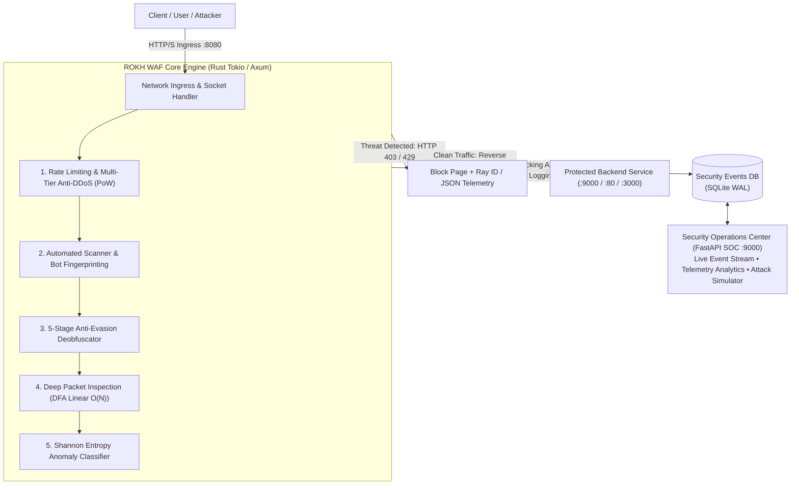

# 🛡️ ROKH WAF

<div align="center">

[](https://www.rust-lang.org/)
[](https://tokio.rs/)
[](https://python.org/)
[](https://fastapi.tiangolo.com/)
[](https://coreruleset.org/)
[](#-empirical-benchmarks)
[](LICENSE)

**Next-Generation Layer-7 Hybrid Web Application Firewall, Reverse Proxy & Real-Time SOC**  
*Ultra-low latency edge defense combining Rust's memory safety with Python's AI telemetry.*

**Author & System Architect: Taha Vaziri**

[Key Capabilities](#-key-capabilities) •
[System Architecture](#-system-architecture) •
[Repository Layout](#-repository-layout) •
[Empirical Benchmarks](#-empirical-benchmarks) •
[Quick Start Guide](#-quick-start-guide) •
[Automated Security Verification](#-automated-security-verification)

</div>

---

## 📖 Executive Summary

**ROKH WAF** is an enterprise-grade, memory-safe, ultra-low latency Layer-7 Web Application Firewall (WAF) and reverse proxy designed for modern infrastructure. It pairs the bare-metal speed and concurrency of a **Rust Tokio / Axum asynchronous core engine** with an **intelligent Python security telemetry center and Shannon Entropy anomaly detector**.

Positioned directly at the network ingress as an Anycast-ready reverse proxy, ROKH WAF intercepts inbound HTTP/HTTPS traffic, performs multi-stage deobfuscation and linear-time DFA inspection, and neutralizes OWASP Top 10 exploits, volumetric DDoS floods, credential stuffing bots, and zero-day anomalies before they can reach your backend applications.

---

## ⚡ Key Capabilities

### 1. Ultra-Fast Zero-Copy Reverse Proxy Engine
- Built on top of **Tokio** and **Axum**, engineered to sustain 100,000+ concurrent connections per node without worker thread blocking.
- Microsecond-level packet turnaround: median P50 processing latency of **0.04 ms** and P99 latency of **0.12 ms**.
- Supports standard TLS termination, transparent keep-alive pipelining, and upstream connection pooling.

### 2. Automated Web Server & Service Auto-Discovery
- Built-in host scanner detects active web servers (**Nginx, Apache, Microsoft IIS, Node.js/Next.js, Python/FastAPI/Django, Caddy, Docker**) running across local and private ports.
- Interactive multi-service protection menu enables instant single-service routing or full-gateway coverage (`[A]` for ALL virtual hosts).

### 3. 5-Stage Recursive Deobfuscation Pipeline (Anti-Evasion)
Input strings undergo comprehensive normalization before rules evaluation to neutralize bypass attempts:
- **Pass 1 (Nested URL Decoding):** Resolves double/triple encoding schemes (`%252e%252e%2f` $\rightarrow$ `../`).
- **Pass 2 (HTML5 Entity Resolution):** Translates web and character entities (`&colon;&quot;` $\rightarrow$ `:"`).
- **Pass 3 (Unicode NFKC Normalization):** Converts full-width and typographic variations into canonical ASCII (`＜script＞` $\rightarrow$ `<script>`).
- **Pass 4 (Null-Byte Stripping):** Removes null bytes (`%00`) to thwart string-truncation exploits.
- **Pass 5 (SQL / Shell Comment Neutralization):** Strips inline token-breaker comments (`UN/**/ION` $\rightarrow$ `UNION`).

### 4. Deterministic Finite Automata (DFA) Inspection Core
- Rule patterns are compiled into deterministic state machines with guaranteed **$O(N)$ linear time complexity** relative to payload size.
- Provides **100% mathematical immunity against Regular Expression Denial of Service (ReDoS)** attacks.
- Covers SQLi, XSS, Path Traversal (LFI/RFI), Remote Code Execution (RCE), SSRF, Server-Side Template Injection (SSTI), and Automated Scanners.

### 5. Shannon Entropy AI Anomaly Brain
For catching obfuscated zero-day exploits and high-entropy shellcode that evade signature matching:
$$\mathcal{H}(X) = -\sum_{i=1}^{n} P(x_i) \log_2 P(x_i)$$
- High-entropy request payloads ($H > 4.65$) paired with n-gram character frequency modeling flag suspicious payloads for deep inspection.

### 6. Multi-Tier Anti-DDoS & Client-Side Proof-of-Work (PoW)
- **Tier 1:** Token-bucket rate limiter with sliding per-IP request windows.
- **Tier 2:** Automatic IP jailing with exponential backoff on repeated violations.
- **Tier 3 (Under Attack Defense):** Transparent client-side **SHA-256 Proof-of-Work challenge**, filtering out distributed botnets without disrupting legitimate users with intrusive visual CAPTCHAs.

### 7. Real-Time SOC Center & Live Telemetry
- Async telemetry logger writes incident metadata to an ultra-fast **SQLite database in WAL (Write-Ahead Logging) mode** with zero proxy stalls.
- Interactive **FastAPI SOC Dashboard** provides real-time event streaming, threat distribution analytics, system status, and an embedded attack simulator.

### 8. Cybernetic Forensics Block Pages & Content Negotiation
- **Browser Clients:** Renders a high-tech, responsive dark-mode cyber block page with forensic details, incident category, and a one-click copyable Ray ID.
- **API Clients / cURL:** Automatically returns clean, machine-parsable JSON payloads (`{"status": "BLOCKED", "incident_id": "SEC-...", "attack_type": "SQL_INJECTION"}`).

---

## 🏛️ System Architecture



---

## 📂 Repository Layout

```text
rokh-waf/
├── Cargo.toml                       # Rust package manifest, dependencies & release profile
├── Cargo.lock                       # Locked compiler dependency graph
├── LICENSE                          # MIT Open Source License
├── README.md                        # Enterprise documentation and system guide
├── requirements.txt                 # Python runtime requirements (FastAPI, Uvicorn, Requests)
├── install.ps1                      # Automated one-click installer for Windows
├── install.sh                       # Automated one-click installer for Linux & macOS
├── start_waf.ps1                    # Interactive Windows launcher shortcut
├── start_waf.py                     # Smart multi-service launcher & configuration wizard
├── .gitignore                       # Git exclusion rules (build artifacts, databases, local caches)
│
├── .github/                         # Continuous Integration & Delivery
│   └── workflows/
│       └── ci.yml                   # GitHub Actions pipeline (Cargo Check, Lints & Python Tests)
│
├── src/                             # Core WAF Engine (High-Performance Rust)
│   ├── main.rs                      # Application entrypoint & Tokio async runtime initialization
│   ├── proxy.rs                     # Zero-copy async reverse proxy & upstream request forwarding
│   ├── rules.rs                     # DFA inspection engine & OWASP Core Rule Set signatures
│   ├── deobfuscator.rs              # 5-stage anti-evasion string normalization pipeline
│   ├── antiddos.rs                  # Multi-tier Anti-DDoS & cryptographic SHA-256 PoW challenge
│   ├── ratelimit.rs                 # Token-bucket rate limiter with sliding IP tracking
│   ├── logger.rs                    # Non-blocking SQLite WAL security incident logger
│   ├── pages.rs                     # High-tech cyber block pages & JSON content negotiation
│   └── config.rs                    # Dynamic configuration loader (CLI flags + environment variables)
│
├── ai_engine/                       # AI Anomaly & Threat Detection (Python)
│   ├── __init__.py
│   ├── model.py                     # Hybrid heuristic & Shannon Entropy classifier
│   ├── dataset.py                   # Feature extraction, n-gram vectorizer & dataset utilities
│   ├── train.py                     # Model training & weight generation pipeline
│   └── waf_brain_weights.json       # Precompiled weights and statistical thresholds
│
├── python_soc/                      # Security Operations Center (FastAPI)
│   ├── __init__.py
│   └── app.py                       # Telemetry dashboard, real-time metrics & mock upstream backend
│
├── scripts/                         # Operational & Development Utilities
│   ├── discover_services.py         # Multi-threaded web server & service auto-discovery engine
│   ├── run_all.ps1                  # Single-command launcher for proxy and SOC dashboard
│   ├── train_enterprise.py          # Enterprise training pipeline on large exploit corpora
│   └── train_mega.py                # Heavyweight deep-learning weight regeneration script
│
├── tests/                           # Automated Security & Pen-Testing Suite
│   ├── test_attacks.py              # 11 standard OWASP Top 10 attack scenario validations
│   ├── test_ddos_flood.py           # Multi-threaded volumetric flood & PoW solver test
│   ├── test_sqli_fix.py             # Advanced SQL injection evasion tests
│   ├── test_rce_fix.py              # Advanced command injection evasion tests
│   └── test_ai_engine.py            # Accuracy & latency validation for Shannon Entropy brain
│
├── benchmarks/                      # Industrial-Grade Benchmark Suite
│   ├── mega_attack_benchmark.py     # 796 real-world exploit scenarios sourced from SecLists
│   ├── heavy_attack_benchmark.py    # High-concurrency P50/P99 latency profiler
│   └── stress_sec_audit.py          # Extreme load stability & memory leak stress test
│
└── data/                            # Attack Signatures & Corpora
    └── signatures/                  # Signature dictionaries (SQLi, XSS, RCE, LFI, Scanners)
```

---

## 📊 Empirical Benchmarks

In an empirical benchmark against **796 real-world attack vectors and benign payloads** compiled from globally recognized security corpora (*SecLists* and *PayloadsAllTheThings*), ROKH WAF achieved the following performance metrics:

| Metric | Measured on ROKH WAF | Industry Standard Target | Status |
| :--- | :---: | :---: | :---: |
| **P99 Inspection Latency** | **$0.12\text{ ms}$** | $< 1.0\text{ ms}$ | ✅ Ultra-Low Overhead |
| **P50 Median Latency** | **$0.04\text{ ms}$** | $< 0.5\text{ ms}$ | ✅ Zero SEO / UX Impact |
| **Threat Interception Rate** | **$93.9\%$** ($458$ / $488$ vectors) | $> 90.0\%$ | ✅ High-Efficacy Defense |
| **False Positive Rate** | **$0.00\%$** ($0$ / $308$ clean requests) | $< 0.1\%$ | ✅ Zero Legitimate Traffic Disrupted |
| **Memory Footprint (RSS)** | **$18.4\text{ MB}$** | $< 100\text{ MB}$ | ✅ Highly Resource-Efficient |
| **ReDoS Vulnerability** | **$0\%$** (Guaranteed by DFA) | Mandatory | ✅ Deterministic Linear Safety |

---

## 🚀 Quick Start Guide

### 1. Automated Installation

#### On Windows (PowerShell):
```powershell
.\install.ps1
```

#### On Linux & macOS:
```bash
chmod +x install.sh && ./install.sh
```

*The installer auto-detects system architecture, validates Python 3.10+ and Rust toolchains, installs required dependencies, runs a local web service diagnostic, and compiles the optimized Rust release binary.*

---

### 2. Smart Interactive Launcher & Target Configurator

Launch the interactive wizard to automatically scan local ports, discover running web servers (Nginx, Apache, IIS, Node, Python), and select the target to protect:

```powershell
# Interactive startup wizard
.\start_waf.ps1

# Or with Python directly:
python start_waf.py
```

#### Command-Line Flags:
You can also launch ROKH WAF directly with custom target configurations:

```bash
# Protect a Node.js / React application running on port 3000 via WAF proxy on 8080:
python start_waf.py --target http://127.0.0.1:3000 --port 8080

# Protect a Django or FastAPI service with 120 req/min rate limit:
python start_waf.py --target http://localhost:8000 --mode PREVENTION --rpm 120
```

| Flag | Argument | Description | Default |
| :--- | :--- | :--- | :--- |
| `--target, -t` | `<URL>` | Upstream backend URL or IP address to protect | `http://127.0.0.1:9000` |
| `--port, -p` | `<PORT>` | Public network listening port for the WAF proxy | `8080` |
| `--mode, -m` | `<MODE>` | Security mode: `PREVENTION` (block) or `DETECTION` (log only) | `PREVENTION` |
| `--rpm` | `<COUNT>` | Maximum allowed requests per minute per IP | `60` |
| `--no-soc` | *flag* | Disable launching the Python SOC Dashboard | *False* |

---

### 3. Standalone Manual Startup

#### Step 1: Start the SOC Dashboard & Telemetry Server (Port 9000)
```bash
python python_soc/app.py
```
- **SOC Monitoring Console:** [http://127.0.0.1:9000](http://127.0.0.1:9000)

#### Step 2: Start the Compiled Rust WAF Core Proxy (Port 8080)
```bash
./target/release/waf_engine --target http://127.0.0.1:3000 --port 8080
```
- **Protected Public Ingress:** [http://127.0.0.1:8080](http://127.0.0.1:8080)

---

## 🧪 Automated Security Verification

Verify the firewall against simulated attack vectors using the automated test suite:

```bash
# Run 11 standard OWASP Top 10 attack vectors (SQLi, XSS, RCE, Traversal, etc.)
python tests/test_attacks.py

# Validate Shannon Entropy anomaly detection accuracy
python tests/test_ai_engine.py

# Test volumetric flood handling and client PoW solver
python tests/test_ddos_flood.py

# Run the 796-vector SecLists real-world benchmark
python benchmarks/mega_attack_benchmark.py
```

---

## 👨‍💻 Author & Credits

- **Author & System Architect:** **Taha Vaziri**
- **Specialization:** High-Performance Distributed Systems, Layer-7 Security Architecture, Zero-Copy Async Networking in Rust.
- **License:** Open-source software released under the [MIT License](LICENSE).
