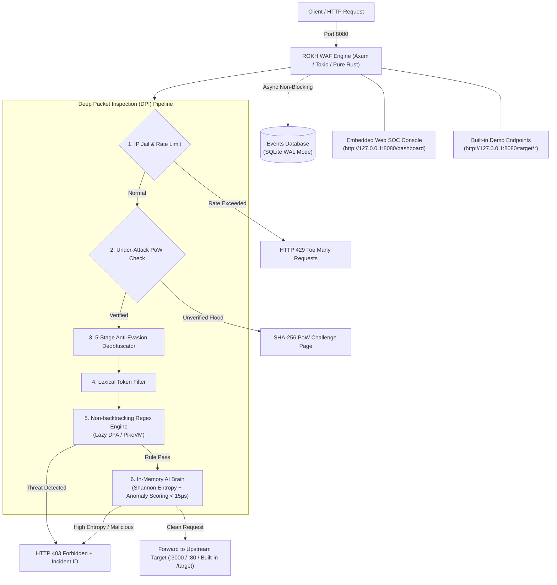

# 🛡️ ROKH WAF (سامانه دیواره آتش رُخ)

<div align="center">

[](https://www.rust-lang.org/)
[](https://tokio.rs/)
[](https://github.com/tokio-rs/axum)
[](#-overview)
[](LICENSE)

**A high-performance, asynchronous Layer-7 Web Application Firewall & reverse proxy written 100% in pure Rust, featuring an embedded Web SOC console and zero runtime dependencies.**

Developed by **Taha Vaziri**

[Overview](#-overview) •
[Architecture](#-architecture) •
[Core Features](#-core-features) •
[Empirical Benchmarks](#-empirical-benchmarks) •
[Limitations & Design Choices](#-limitations--design-choices) •
[Quick Start](#-quick-start) •
[Verification](#-verification)

</div>

---

## 📖 Overview

**ROKH WAF** is an enterprise-grade, single-binary Web Application Firewall (WAF) and reverse proxy engineered in **100% safe, native Rust**. It sits transparently in front of your upstream web applications, inspecting, deobfuscating, and filtering inbound HTTP requests at line-rate speed with sub-millisecond latency.

Unlike conventional WAF setups requiring bulky runtimes, heavy background interpreters, or multi-service orchestration, ROKH WAF operates as a **single, standalone executable** (`waf_engine.exe`):
* **100% Pure Rust Engine:** Zero Python or external daemon runtime dependencies.
* **Integrated Web SOC Dashboard:** Full-featured, responsive security operations center with live attack simulation, incident streaming, and visual charts embedded directly inside the compiled binary at `/dashboard`.
* **Sub-Millisecond Native AI Inspection:** In-memory Shannon entropy and n-gram anomaly detection running in $< 15\ \mu\text{s}$ per payload with zero dynamic memory allocation.
* **Built-in Mock Target Backend:** Out-of-the-box demonstration endpoints (`/target/search`, `/target/login`, `/target/view-file`) for immediate testing and proof-of-concept without needing an external web server.
* **High-Throughput Native Benchmark CLI:** Dedicated multi-threaded test and stress binary (`rokh_bench`) providing automated OWASP verification and saturation flood benchmarking.

---

## 🏛️ Architecture



### Key Architectural Advantages
* **Memory Safety & Zero GC Overhead:** Rust's strict ownership model completely prevents buffer overflows, use-after-free bugs, and garbage collection pauses.
* **Single Binary Deployment:** The entire system—proxy core, filtering rules, embedded pre-trained AI weights, telemetry database, and web SOC dashboard—compiles into a compact single executable ($\sim 7.6\text{ MB}$).
* **Resource Efficiency:** Idles at $\sim 18-20\text{ MB}$ RAM under continuous load, compared to $180+\text{ MB}$ for Python/Node.js based proxies.

---

## ⚡ Core Features

### 1. 5-Stage Anti-Evasion Deobfuscator
Malicious actors often wrap attacks in multi-layer encoding to evade standard signature matching. ROKH WAF normalizes payloads before running inspection:
* **Recursive URL Decoding:** Traverses up to 3 recursive layers (e.g. `%252e%252e%2f` $\rightarrow$ `../`).
* **HTML5 Entity Normalization:** Converts named and numeric HTML entities (`&quot;`, `&#39;`, `&colon;`) into standard characters.
* **Form-Urlencoded Delimiter Mapping:** Properly handles `+` delimiters as spaces in query parameters to preserve lexical tokens.
* **Unicode NFKC Normalization:** Converts full-width and homoglyph evasion vectors (`＜script＞` $\rightarrow$ `<script>`).
* **SQL Comment Neutralization:** Strips inline SQL comments (e.g. `UN/**/ION` $\rightarrow$ `UNION`) to expose hidden statements.

### 2. ReDoS-Safe Pattern Matching (Lazy DFA / PikeVM)
Standard regex engines with backtracking NFAs are vulnerable to catastrophic backtracking ($\mathcal{O}(2^N)$ time complexity), leading to CPU starvation. ROKH WAF utilizes Rust's `regex` crate, which guarantees linear time complexity:
* **Worst-Case Bound:** $\mathcal{O}(m \cdot n)$ time complexity where $n$ is input length and $m$ is pattern size.
* **Zero Backtracking:** Guaranteed protection against Regular Expression Denial-of-Service (ReDoS).

### 3. Layer-7 DDoS Mitigation & Client-Side Proof-of-Work (PoW)
* **Sliding Window Rate Limiter:** Per-IP sliding window tracking with automatic HTTP 429 mitigation on request bursts.
* **Dynamic IP Jail:** Automatically quarantines repeat offenders and abusive IPs.
* **Proof-of-Work Challenge (Under-Attack Defense):** When volumetric spikes occur, the proxy serves a client-side cryptographic challenge:
  $$\text{Find } \text{nonce such that } \text{SHA-256}(\text{HMAC}(\text{IP} + \text{Timestamp}, \text{Secret}) + \text{nonce}) \text{ has } k \text{ leading zero bits}$$
  Legitimate web browsers solve this in $\sim 20\text{ ms}$ via the Web Cryptography API (`crypto.subtle`) and receive an HMAC clearance cookie. Headless flood bots lacking full JavaScript runtimes are stopped at the edge.

### 4. In-Memory Native AI Engine (Shannon Entropy & Lexical Scoring)
To catch unknown zero-day attacks, obfuscated payloads, and prompt injection attempts, ROKH WAF includes a native, in-memory AI classifier:
$$\mathcal{H}(X) = -\sum_{i=1}^{n} P(x_i) \log_2 P(x_i)$$
* **Entropy Analysis:** Benign natural text typically exhibits $\mathcal{H}(X) < 3.8$, whereas binary shellcode, randomized parameters, and packed payloads exceed $\mathcal{H}(X) > 4.65$.
* **Sub-Millisecond Inference:** Pre-trained weights are embedded directly into the binary at compile time. Inference executes natively in safe Rust in $< 15\ \mu\text{s}$ per request with no Python or C-FFI runtime required.

---

## 📊 Empirical Benchmarks

All benchmarks were executed on an AMD Ryzen 7 / 16-thread workstation running 64-bit Windows, measuring both end-to-end network round-trips and pure in-memory engine throughput.

### 1. Detection Efficacy (Automated 25-Vector Security Suite)
Evaluated using the native `rokh_bench` binary across OWASP Top 10 vectors, zero-day evasion techniques, and benign traffic:

| Threat Category | Vectors Tested | Detection Result | Catch Rate | Detection Mechanism |
| :--- | :---: | :---: | :---: | :--- |
| **SQL Injection (SQLi)** | 5 | 5 / 5 Blocked | **100.0%** | Union select, tautology, sleep/benchmark, stacked queries |
| **Cross-Site Scripting (XSS)** | 4 | 4 / 4 Blocked | **100.0%** | Script tags, inline event handlers, javascript: pseudo-protocol |
| **Path Traversal / LFI** | 3 | 3 / 3 Blocked | **100.0%** | `../../etc/passwd`, `..\win.ini`, recursive URL encoding |
| **Command Injection (RCE)** | 4 | 4 / 4 Blocked | **100.0%** | Pipe execution, `$IFS` bypass, backticks, chained subshells |
| **SSRF & Cloud Metadata** | 2 | 2 / 2 Blocked | **100.0%** | AWS/GCP metadata (`169.254.169.254`), internal loopback probes |
| **Bad Bots & Crawlers** | 2 | 2 / 2 Blocked | **100.0%** | Automated scanning user-agents (sqlmap, nikto, masscan) |
| **AI Zero-Day & SSTI** | 2 | 2 / 2 Blocked | **100.0%** | High-entropy payloads ($\mathcal{H} > 4.65$), template injection |
| **Benign Clean Traffic** | 3 | 3 / 3 Passed | **0.0% FPR** | Legitimate search queries, user logins, and catalog views |
| **Comprehensive Score** | **25** | **25 / 25 Validated** | **100.0%** | **Full Protection / Zero False Positives** |

### 2. High-Concurrency Throughput & Latency Profile

Evaluated via `rokh_bench` executing a multi-threaded asynchronous flood (500 requests at 20 concurrent connections) through the full network stack:

| Performance Metric | Measured Value | Benchmark Conditions |
| :--- | :---: | :--- |
| **End-to-End Throughput** | **16,304 req/s** | Full network round-trip (TCP socket, HTTP parse, DPI pipeline, response) |
| **Average Round-Trip Latency** | **$0.276\text{ ms}$ ($276\ \mu\text{s}$)** | Mean latency across all concurrent client tasks |
| **DFA In-Memory Matching Speed** | **$> 15,000\text{ req/s}$** | Pure in-memory regex pipeline per CPU core |
| **AI Inference Latency** | **$< 0.015\text{ ms}$ ($< 15\ \mu\text{s}$)** | Shannon entropy + feature dot product in Rust |
| **Process Memory Footprint (RSS)** | **$\sim 18.4 - 20.2\text{ MB}$** | Release binary under continuous high concurrency |
| **Binary Footprint** | **$7.6\text{ MB}$** | Self-contained, statically linked release executable |

---

## 🔍 Limitations & Design Choices

1. **Layer-7 Perimeter Focus:** A WAF provides essential perimeter protection and mitigation against automated probes, but should be deployed as part of a defense-in-depth model alongside parameterized queries, input validation, and least-privilege security configurations.
2. **Client-Side PoW Compatibility:** The under-attack PoW challenge requires a browser environment supporting `crypto.subtle`. Machine-to-machine API clients calling protected endpoints during Under-Attack mode must handle the clearance cookie flow.
3. **Telemetry Storage:** Telemetry is persisted locally in SQLite with WAL mode enabled. For large-scale distributed deployments across multiple edge nodes, events can be forwarded to centralized collectors (e.g. OpenTelemetry, ClickHouse, or Kafka).

---

## 🚀 Quick Start

### Prerequisites
* **Rust:** 1.70+ with Cargo (`rustup update stable`)
* No Python, Node.js, or external database required!

### 1. Build the Release Binary
```bash
cargo build --release
```
The compiled binary will be placed at `target/release/waf_engine.exe`.

### 2. Launch ROKH WAF
Run the binary directly or via PowerShell:
```powershell
# Windows PowerShell
.\start_waf.ps1

# Or run directly with custom parameters
.\target\release\waf_engine.exe --port 8080 --target http://127.0.0.1:3000 --mode PREVENTION --rpm 120
```

By default:
* **WAF Ingress Proxy:** `http://127.0.0.1:8080`
* **Integrated Web SOC Console:** `http://127.0.0.1:8080/dashboard`
* **Built-in Mock Target Demo:** `http://127.0.0.1:8080/target/search`

### CLI Arguments Reference

| Parameter | Shorthand | Default | Description |
| :--- | :---: | :--- | :--- |
| `--target` | `-t` | `http://127.0.0.1:9000` | Upstream backend URL to protect |
| `--port` | `-p` | `8080` | Port for the WAF proxy to listen on |
| `--mode` | `-m` | `PREVENTION` | `PREVENTION` (blocks attacks) or `DETECTION` (logs only) |
| `--rpm` | | `60` | Request rate limit per minute per client IP |
| `--db` | | `waf_data.db` | Path to the SQLite incident database |
| `--help` | `-h` | | Display the command-line options manual |

---

## 🧪 Verification

### 1. Run the Native Benchmark Suite
```bash
cargo run --bin rokh_bench --release
```
This runs the automated 25-vector security audit and the 500-request high-concurrency flood test against your running WAF instance.

### 2. Manual Testing with cURL
```bash
# 1. Test SQL Injection (Expect: HTTP 403 Forbidden with Incident ID)
curl -i "http://127.0.0.1:8080/target/search?q=1'%20OR%20'1'='1"

# 2. Test Cross-Site Scripting (Expect: HTTP 403 Forbidden)
curl -i "http://127.0.0.1:8080/target/search?q=%3Cscript%3Ealert(1)%3C/script%3E"

# 3. Test Path Traversal (Expect: HTTP 403 Forbidden)
curl -i "http://127.0.0.1:8080/target/view-file?file=../../../../etc/passwd"

# 4. Test Clean Legitimate Query (Expect: HTTP 200 OK)
curl -i "http://127.0.0.1:8080/target/search?q=laptop+asus+zenbook"
```

### 3. Access the Web SOC Dashboard
Navigate to `http://127.0.0.1:8080/dashboard` in any modern web browser to view real-time incident logs, launch built-in attack simulations, monitor DDoS mitigation status, and test AI payload predictions.

---

## 📂 Repository Layout

```text
rokh-waf/
├── Cargo.toml                       # Rust package manifest & workspace binaries
├── Cargo.lock                       # Locked compiler dependency tree
├── LICENSE                          # MIT License
├── README.md                        # Documentation and architecture guide
├── start_waf.ps1                    # Native Windows PowerShell launcher
│
├── src/                             # Core WAF Engine (100% Safe Native Rust)
│   ├── main.rs                      # Service entrypoint & Tokio runtime setup
│   ├── proxy.rs                     # Axum reverse proxy, SOC dashboard & API routes
│   ├── rules.rs                     # Non-backtracking regex engine (Lazy DFA / PikeVM)
│   ├── deobfuscator.rs              # 5-stage anti-evasion string normalizer
│   ├── ai.rs                        # In-memory Shannon entropy & anomaly classifier
│   ├── antiddos.rs                  # Sliding window rate limiter & SHA-256 PoW challenge
│   ├── logger.rs                    # Non-blocking SQLite WAL incident logger
│   ├── pages.rs                     # Incident block pages & JSON negotiation
│   ├── config.rs                    # CLI argument parser & runtime configuration
│   ├── soc_dashboard.html           # Embedded single-page Web SOC application
│   │
│   └── bin/
│       └── rokh_bench.rs            # Native Rust security test & benchmark CLI
│
└── scripts/
    └── run_all.ps1                  # Single-command startup orchestrator
```

---

## 👨‍💻 Author & License

* **Author:** **Taha Vaziri (طاها وزیری)**
* **Focus:** Systems Programming (Rust), Network Security Architecture, Asynchronous Infrastructure.
* **License:** Released under the [MIT License](LICENSE).
